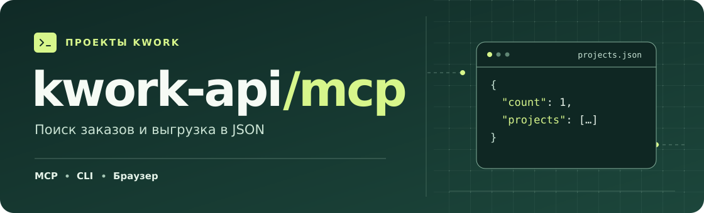

Поиск публичных заказов на [бирже проектов Kwork](https://kwork.ru/projects) с фильтрами по рубрикам, ключевым словам, бюджету и числу откликов. Результаты доступны в JSON через MCP, командную строку и локальную форму в браузере.

| Режим | Как начать |
| --- | --- |
| **MCP** | Подключить `kwork_search_projects` к ассистенту через stdio |
| **Браузер** | Запустить `python3 kwork_projects.py -v` |
| **Терминал** | Запустить `python3 kwork_projects.py --help` |

## Подключение MCP

Требуется Python 3.11+ и клиент с поддержкой локальных MCP-серверов через stdio.

```bash
python3 -m venv mcp/.venv
mcp/.venv/bin/python -m pip install -r mcp/requirements.txt
```

Добавьте запись из [mcp.example.json](mcp/mcp.example.json) в раздел `mcpServers` вашего клиента. Укажите абсолютные пути к `mcp/.venv/bin/python` и `mcp/server.py` в своей копии проекта и перезапустите клиент.

Попросите ассистента, например:

> Найди на Kwork до 10 проектов про Python или FastAPI с бюджетом от 5000 ₽ и максимум 15 откликами. Исключи WordPress.

Инструмент вернёт `count` и массив `projects` с названиями, описаниями, ссылками, бюджетами и датами. По умолчанию поиск охватывает до трёх страниц и возвращает до 20 проектов. Схема аргументов и пример вызова есть в [документации MCP-сервера](mcp/README.md).

## Веб-интерфейс

```bash
python3 kwork_projects.py -v
```

Выберите рубрику, укажите бюджет и слова для поиска. Нажмите **«Найти проекты»**, затем **«Скачать JSON»**. Адрес формы выводится в терминал. Чтобы остановить локальный сервер, нажмите `Ctrl+C`.

## Командная строка

```bash
python3 kwork_projects.py \
  --category 41 --keyword Python --keyword FastAPI --exclude WordPress \
  --min-budget 5000 --max-offers 15 --pages 5 --limit 10 \
  --output projects.json
```

При нескольких `--keyword` достаточно совпадения с любым словом или фразой в названии либо описании. Бюджетные фильтры применяются к желаемому бюджету, а допустимый бюджет возвращается отдельно. Без `--output` JSON выводится в терминал. Для обработки сохранённой страницы биржи без сети передайте `--html projects.html`.

Скрипт читает публичные карточки из HTML Kwork. CLI и браузерная форма работают на стандартной библиотеке Python. MCP-сервер использует [официальный Python SDK](https://py.sdk.modelcontextprotocol.io/).
